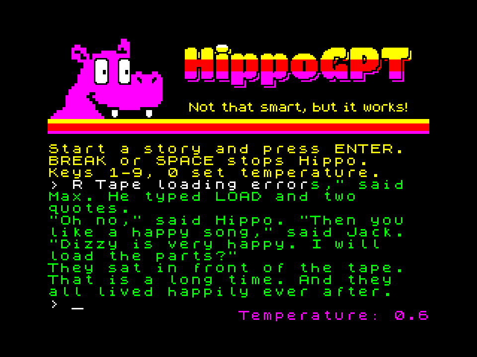
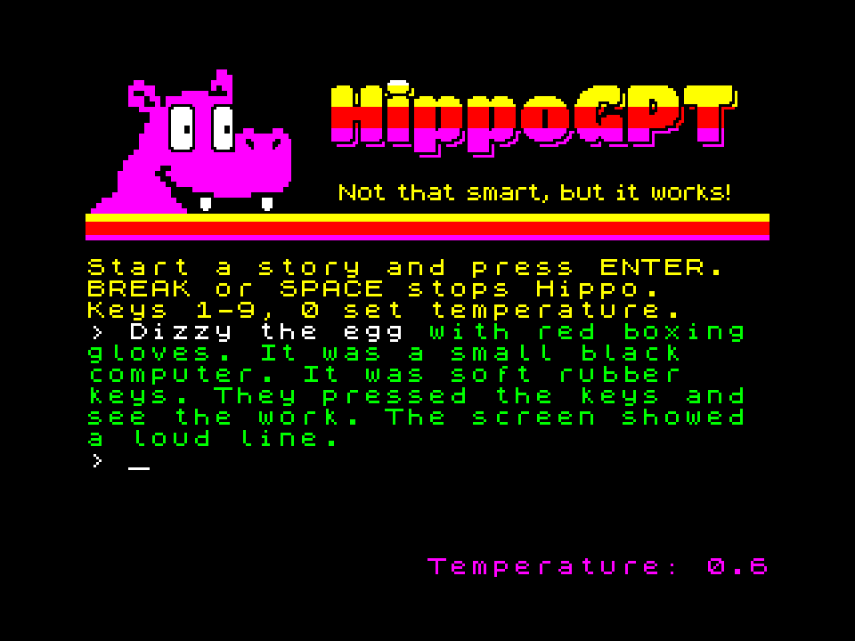
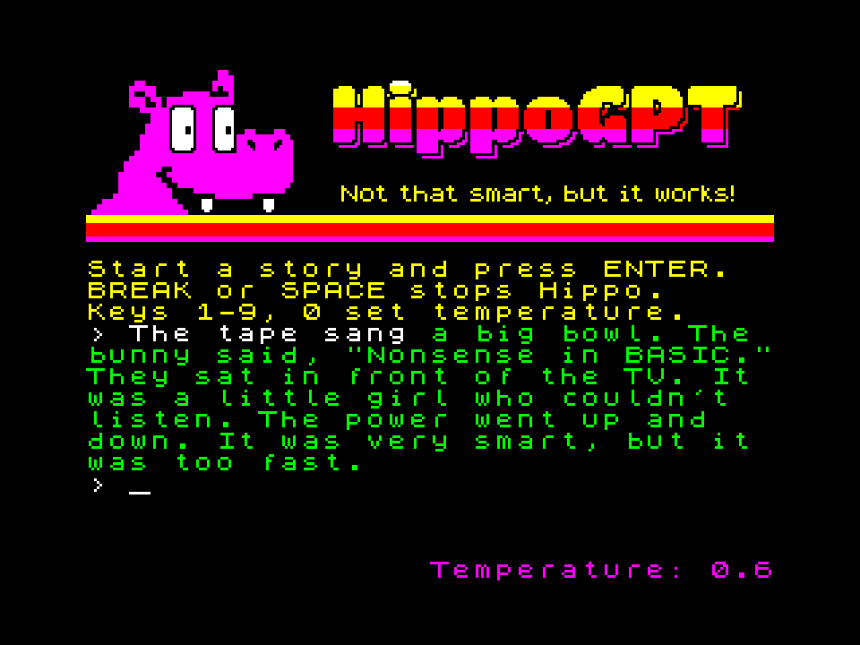

# HippoGPT

*Not that smart, but it works!*



[Русский](#русский) · [English](#english)

## Русский

Учебный проект: языковая модель (крошечный трансформер) на ZX Spectrum. По началу, которое вы набираете, Хиппо
пишет детскую сказку на английском. Весь расчёт идёт в целых числах на Z80 и совпадает с эталоном на Python бит в бит.
Статья о проекте: [Хабр](https://habr.com/ru/articles/1099242/).

### Что получается

- `hippo.trd` и `hippo.scl` — дискета TR-DOS с двумя версиями, загрузчик сам выбирает версию по машине:
  - **128K** (ZX Spectrum 128, +2, Pentagon 128 с Beta Disk): модель на ~120 тыс. параметров, около 4 с на токен;
  - **256** (Scorpion ZS-256 и 1024, Pentagon 512 и 1024, Profi 1024, KAY-1024): та же модель плюс таблицы на входе
    и закреплённое начало сказки, около 4,2 с на токен. Ключевое слово затравки встречается в продолжении в 35% случаев
    против 7% у версии 128K, чужие герои влезают в четыре раза реже.
- `hippo.tap` и `hippo.z80` — версия 128K на ленте и снимок после загрузки ленты.

Управление: наберите начало сказки (до 29 символов) и нажмите ENTER. Цифры 1–9 и 0 задают температуру от 0,1 до 1,0.
BREAK или SPACE останавливает Хиппо. Внизу слева видна версия: «v1.1 128K» или «v1.1 256K».

 

### Состав репозитория

| путь | что |
|---|---|
| `models/hippo128.pt`, `models/hippo256.pt` | обученные модели (чекпойнты PyTorch) версий 128K и 256 |
| `z80/hippo.asm`, `core.asm`, `ui.asm` | программа для Спектрума (sjasmplus); `test_matvec4*.asm` — стенды ядер умножения |
| `ref/intref.py` | целочисленный эталон: каждая операция Z80 в numpy |
| `ref/sampler.py`, `ref/export.py`, `ref/check.py` | выбор токена; чекпойнт -> целочисленная модель; сверка bpc |
| `tools/build128.py`, `build256.py` | модель -> исходники `z80/gen_*` -> sjasmplus -> образы страниц памяти |
| `tools/mktap.py`, `mktrd.py`, `mkdisk.py`, `zx0enc.py` | лента, дискета, загрузчик, упаковщик заставки |
| `tools/zx.py`, `zx128.py`, `zx256.py` | стенд: симулятор SkoolKit с переключением страниц |
| `tools/test_*.py`, `run_tap.py`, `unreal_test.py` | сверки с эталоном на стенде и в эмуляторе |
| `train/` | подготовка данных и обучение (PyTorch) |
| `data/tok512.json` | словарь BPE на 512 токенов (алфавит 64 знака, 0 — конец сказки) |
| `data/tok512_calib.npy` | 256 окон корпуса, по которым экспорт калибрует масштаб |
| `data/speccy/speccy_stories.txt` | 1613 сказок про ZX Spectrum для дообучения |
| `data/aug_lists.json` | имена для подмены в сказках про Спектрум |
| `art/out/hippogpt.scr` | заставка |
| `third_party/zx0/` | распаковщик ZX0 (Einar Saukas, BSD-3) |

### Что нужно

- Python 3.10+ и пакеты из `requirements.txt`: `pip install -r requirements.txt`. torch нужен только для экспорта
  моделей (`ref/export.py`) и обучения; сборка из готовых `build*/intmodel*.pkl` и все сверки на стенде работают без него.
- [sjasmplus](https://github.com/z00m128/sjasmplus) 1.24: в `PATH` или путь в переменной `SJASMPLUS`.
- Если torch стоит в другом окружении Python, путь к его `python` — в переменной `HIPPO_TORCH_PY`
  (сборка запускает `ref/export.py` отдельным процессом).
- Для обучения — видеокарта с CUDA и корпус TinyStories (около 2 ГБ текста).
- Для проверки в эмуляторе (необязательно, только Windows) — Unreal Speccy 0.39.0 с ПЗУ из его поставки,
  путь к папке — в переменной `UNREAL_DIR`.

Все команды выполняются из корня репозитория. В консоли Windows для русского вывода: `set PYTHONIOENCODING=utf-8`.

### Сборка из готовых моделей

```
python tools/build128.py models/hippo128.pt
python tools/build256.py models/hippo256.pt
python tools/mktap.py
tap2sna.py -c machine=128 build/hippo.tap build/hippo.z80
python tools/mkdisk.py
```

1. `build128.py` экспортирует модель в `build/intmodel128.pkl`, пишет `z80/gen_*` и собирает `build/bank0..7.bin`
   и `build/hippo.sym`.
2. `build256.py` делает то же для версии 256: `build256/intmodel256.pkl`, `build256/bank0..15.bin`, `build256/hippo.sym`.
3. `mktap.py` собирает ленту версии 128K `build/hippo.tap`.
4. `tap2sna.py` из SkoolKit загружает ленту в симуляторе 128K и пишет снимок `build/hippo.z80`.
5. `mkdisk.py` собирает дискету с обеими версиями: `build/hippo.trd` и `build/hippo.scl`.

Обе сборки пишут общие файлы `z80/gen_*`, поэтому каждую версию собирайте целиком своей командой. `mktap.py` и
`mkdisk.py` берут уже готовые `build/` и `build256/`. Сборка детерминирована: одни и те же модели дают побайтно
одинаковые файлы. Пересобрать без torch можно из готовой целочисленной модели: `python tools/build128.py
build/intmodel128.pkl`.

### Проверка на стенде

```
python tools/test_story128.py "Captain Nemo" 3
python tools/test_story128.py "Dizzy the egg" 2 --256
python tools/test_matvec4.py
python tools/test_matvec4n.py
python tools/run_tap.py "Kevin the koala" 8
python tools/test_break.py
```

- `test_story128.py "затравка" зерно [--256]` гоняет программу на стенде. Он сверяет с эталоном разбор затравки
  (159 строк) и каждый выбранный токен сказки. Ждите «разбор: ... совпали с эталоном» и «история: OK». Экран
  сохраняется в `build/story.png`.
- `test_matvec4*.py` проверяют ядра умножения матриц на вектор, ждите `ok=True`.
- `run_tap.py` проверяет, что снимок после ленты совпадает с образами страниц, набирает затравку и пишет токены.
- `test_break.py` проверяет, что BREAK посреди токена сразу возвращает к вводу.
- `test_forward128.py [токенов]` сверяет все логиты версии 128K. Ему нужен `data/tok512_valid.u16` (см. «Обучение
  заново»).

Стенд — C-ядро симулятора SkoolKit, примерно в 500 раз быстрее Спектрума. Страницы 8–15 версии 256 стенд изображает
подменой содержимого банков (`tools/zx256.py`); страницы 10 и 13 он изображать не умеет, и сборка их не занимает.

### Проверка в Unreal Speccy (Windows, необязательно)

`UNREAL_DIR` должен указывать на папку Unreal Speccy 0.39.0 с `unreal.exe`, `unreal.ini` и ПЗУ. В `unreal.ini`
поставьте `driver=gdi`, если Unreal падает с DDERR_NODIRECTDRAWHW. Ещё поставьте `Enabled=0` в разделе `[SOUND]`:
без звука эмулятор идёт на максимальной скорости. Потом:

```
python tools/unreal_test.py all
python tools/unreal_test.py profi "Dizzy the egg"
```

Скрипт по очереди настраивает в `unreal.ini` машины: Pentagon 128, 512 и 1024, Scorpion 256 и 1024, KAY-1024,
Profi 1024. Он задаёт модель памяти, её набор ПЗУ, сброс в TR-DOS и дискету `build/hippo.trd`, затем запускает
эмулятор. Окно и клавиатура не нужны, всё идёт через память процесса. Скрипт смотрит, какая версия загрузилась и
какая схема страниц выбрана, сверяет страницы со сборкой, набирает затравки и сверяет сказки с эталоном. Набор ПЗУ
задаёт `[ROM] ROMSET`: без него Unreal берёт ПЗУ Пентагона для любой модели памяти.

### Как это устроено

**Модель.**
- Размеры: d=64, 2 слоя, 4 головы внимания с общими K и V (dh=16), MLP на 256 с ReLU².
- Окно 64 токена: кольцевой кэш внимания с обучаемой добавкой по расстоянию.
- Словарь BPE на 512 токенов над алфавитом из 64 знаков. В нём только то, что есть в шрифте; 0 означает конец сказки.
- Веса по 4 бита, обучены с квантованием и обучаемым шагом (LSQ). Вложения тоже по 4 бита.

**Расчёт на Z80.**
- Умножение матрицы на вектор идёт через таблицы кратных, около 50 тактов на вес.
- Скалярные произведения внимания считаются через квадраты, нормализация и softmax — через таблицы.
- `ref/intref.py` повторяет каждую операцию в целых числах, и Z80 совпадает с ним бит в бит.

**Версия 256** добавляет:
- вложение предыдущего токена (512×64);
- таблицу пар токенов на 2048 строк. Строка выбирается хешем `h1[prev] ^ h2[tok]`. Обе таблицы — это два лишних
  чтения строк на токен, почти ноль тактов;
- 16 первых токенов сказки (конец прошлой сказки и затравка). Они навсегда остаются в кэше внимания, с отдельной
  добавкой к счёту на каждую голову. Именно это держит тему затравки, стоит около 4,5% тактов.

**Затравка.**
- Разбирается теми же слияниями BPE, что и при обучении.
- Если затравка кончается не буквой, последний токен «склеивается»: первый выбранный токен должен его продолжить.
- Если затравка кончается буквой, слово считается законченным, и первый токен не может начинаться с буквы.
- Первые 32 токена сказка не кончается.
- Генератор случайных чисел — xorshift16, его затравку даёт регистр R в момент нажатия ENTER.

### Память

| страница | версия 128K | версия 256 |
|---|---|---|
| 5 (#4000) | экран, буферы и стек, таблицы, множители строк, интерфейс | так же |
| 2 (#8000) | таблица кратных, квадраты, exp, горячий код | так же |
| 0, 1 | W1 обоих слоёв (байт на вес) | так же |
| 3 | W2 обоих слоёв (по 4 бита) | так же |
| 4 | вложения (вход и выходной слой) | так же |
| 6 | внимание слоя 0, Wq/Wk/Wv слоя 1 | так же |
| 7 | Wo слоя 1, кэш внимания, строки токенов, слияния BPE | закреплённые K/V, кэш, строки, слияния |
| 8 | — | вложение предыдущего токена |
| 9 | — | Wo слоя 1, хеши пары, множители входных таблиц |
| 11, 12, 14, 15 | — | таблица пар |

Бит 3 номера страницы у машин свой: у Pentagon 512 и 1024 это бит 6 порта #7FFD, у Scorpion и KAY — бит 4 порта
#1FFD, у Profi — бит 0 порта #DFFD. Все переключения идут через `setbank` (`z80/hippo.asm`). Он начинается с перехода
на нужный вариант, и этот переход ставит загрузчик.

**Загрузчик дискеты** (`tools/mkdisk.py`):
1. Читает каталог и показывает заставку, упакованную ZX0 (717 байт).
2. По очереди проверяет схемы в порядке #7FFD, #1FFD, #DFFD: кладёт метки в страницы 0 и 8 и смотрит, уцелела ли
   первая. Порядок важен: на Пентагоне запись в #1FFD попадает в #7FFD.
3. Если сработала одна из схем, грузит версию 256. Если нет, но страница 1 отдельна от страницы 0, — версию 128K.
   Иначе пишет «HippoGPT needs 128K memory.».

Файлы (`h128*` и `h256*`) ищутся по каталогу и читаются функцией 5 TR-DOS (#3D13) прямо в нужные страницы.

### Обучение заново

**Данные.** Не запускайте `train/bpe.py`: он заново учит словарь, и готовые модели с ним не совпадут.

1. Скачайте `TinyStoriesV2-GPT4-train.txt` и `TinyStoriesV2-GPT4-valid.txt` из
   [roneneldan/TinyStories](https://huggingface.co/datasets/roneneldan/TinyStories) в `data/`.
2. `python train/prep_data.py` пишет `data/train.u8` и `data/valid.u8`: символы алфавита из 64 знаков, 0 — конец
   сказки.
3. `python train/retok.py 512 8` пишет `data/tok512_train.u16` и `data/tok512_valid.u16`. Токены берутся по
   словарю `data/tok512.json`, работают 8 процессов.
4. `python train/prep_speccy.py` пишет `data/speccy512_{train,valid}.u16`: 1513 и 100 сказок про Спектрум.
5. `python train/augment.py speccy` пишет `data/speccy512aug_{train,valid}.u16`: 16 копий сказок, где имена героев
   заменены на обычные имена из TinyStories того же пола. Списки имён уже лежат в `data/aug_lists.json`; собрать их
   заново можно командой `python train/augment.py lists`, для неё нужен nltk с корпусами names и wordnet.

**Версия 128K** (каждая ступень стартует с предыдущей):

```
python train/train.py --name t1_float512 --data tok512 --vocab 512 --quant 0
python train/train.py --name t2_ft512_int4_lsq --init runs/t1_float512/last.pt --steps 10000 --lr 1e-3 --warmup 200 --data tok512 --vocab 512 --wq int4 --wlsq 1
python train/train.py --name t3_ft512_int4_emb4 --init runs/t2_ft512_int4_lsq/last.pt --steps 6000 --lr 5e-4 --warmup 200 --data tok512 --vocab 512 --wq int4 --wlsq 1 --emb-q int4
python train/train.py --name t4_speccy50 --init runs/t3_ft512_int4_emb4/last.pt --steps 3000 --lr 3e-4 --warmup 100 --eval-every 500 --data tok512 --mix speccy512:0.5 --vocab 512 --wq int4 --wlsq 1 --emb-q int4
python train/train.py --name t5_eos --init runs/t4_speccy50/last.pt --steps 3000 --lr 3e-4 --warmup 100 --eval-every 500 --data tok512 --mix speccy512:0.5 --vocab 512 --wq int4 --wlsq 1 --emb-q int4
```

**Версия 256:**

```
python train/train.py --name s_f13 --data tok512 --vocab 512 --quant 0 --prev-emb 1 --bigram 2048 --pin 16
python train/train.py --name s_q13 --init runs/s_f13/last.pt --steps 10000 --lr 1e-3 --warmup 200 --data tok512 --vocab 512 --wq int4 --wlsq 1 --emb-q int4 --prev-emb 1 --bigram 2048 --pin 16
python train/train.py --name s_t7_sp10 --init runs/s_q13/last.pt --steps 3000 --lr 3e-4 --warmup 100 --eval-every 500 --data tok512 --mix speccy512aug:0.1 --vocab 512 --wq int4 --wlsq 1 --emb-q int4 --prev-emb 1 --bigram 2048 --pin 16
```

Первая ступень каждой цепочки учит модель без квантования (20000 шагов). Вторая дообучает её с 4-битными весами,
третья добавляет 4-битные вложения. Последние ступени подмешивают сказки про Спектрум. Каждый прогон пишет
`runs/<имя>/last.pt` и `log.json`. На RTX 4070 1000 шагов без квантования занимают около 23 секунд. Не запускайте
больше двух прогонов на одной видеокарте: они сильно замедляются.

Повтор по этому рецепту даст модель той же постройки, но не те же веса. Тому три причины:
- t1–t4 учились на более ранней токенизации корпуса, где не было токенов конца сказки;
- первая ступень версии 256 оборвалась на шаге 7000 и была продолжена ещё на 13000 шагов с `--lr 2e-3 --warmup 200`;
- подмена имён в сказках про Спектрум тогда зависела от случайной соли хеша строк, теперь она воспроизводима.

Дальше:
- `python ref/check.py runs/s_t7_sp10/last.pt` сравнивает bpc модели PyTorch и целочисленного эталона;
- `python train/topic_eval.py runs/s_t7_sp10/last.pt --no-heal-words` меряет, держится ли модель темы затравки;
- `python train/sample.py runs/s_t7_sp10/last.pt 3 0.6 "Once upon a time"` печатает примеры;
- `python tools/build256.py runs/s_t7_sp10/last.pt` собирает версию, дальше всё как в разделе «Сборка».

Экспорт калибрует масштаб остаточного потока по 256 окнам корпуса. Эти окна сохранены в `data/tok512_calib.npy`,
поэтому экспорт работает и без корпуса.

### Для ИИ-агентов

- Не коммитьте сгенерированное: `build/`, `build256/`, `runs/`, `z80/gen_*`, `data/*.u8`, `data/*.u16`. Всё это
  перечислено в `.gitignore` и собирается командами выше.
- После любой правки в `z80/` или `ref/` соберите обе версии и прогоните `tools/test_story128.py` для 128K и с
  `--256`. Должно быть «история: OK». Код Z80 обязан совпадать с `ref/intref.py` бит в бит, поэтому, меняя
  арифметику, меняйте обе стороны.
- Если правка не должна менять поведение, сравните новые `build*/bank*.bin`, `hippo.tap` и `hippo.trd` со
  старыми побайтно.
- `build128.py` и `build256.py` перезаписывают общие `z80/gen_*`. Собирайте в порядке из раздела «Сборка».
- Затравка на Спектруме не длиннее 29 символов (`PROMPT_MAX`): длинные затравки в тестах обрезайте.
- Пути этой машины задавайте переменными `SJASMPLUS`, `HIPPO_TORCH_PY`, `UNREAL_DIR`, а не в коде.

### Источники

- Корпус TinyStories (Eldan, Li, 2023; CDLA-Sharing-1.0) в репозиторий не входит, его нужно скачать.
- Сказки про Спектрум (`data/speccy/speccy_stories.txt`) написаны моделями gemma4:12b и Claude Haiku по описанию
  с фактами о Спектруме, в стиле TinyStories. Отфильтрованы автоматически.
- Распаковщик ZX0 — Einar Saukas, лицензия BSD-3 (`third_party/zx0/LICENSE`).

Код и модели — под лицензией MIT (`LICENSE`).

## English

An educational project: a language model (a tiny transformer) on the ZX Spectrum. From the beginning you type,
Hippo writes a children's story in English. All the maths is integer-only on the Z80 and matches the Python
reference bit for bit. Article about the project (in Russian): [Habr](https://habr.com/ru/articles/1099242/).

### What you get

- `hippo.trd` and `hippo.scl` — a TR-DOS disk with two versions; the loader picks the version for the machine:
  - **128K** (ZX Spectrum 128, +2, Pentagon 128 with Beta Disk): a ~120K-parameter model, about 4 s per token;
  - **256** (Scorpion ZS-256 and 1024, Pentagon 512 and 1024, Profi 1024, KAY-1024): the same model plus input
    tables and a pinned story start, about 4.2 s per token. A key word of the prompt shows up in the continuation
    35% of the time versus 7% for the 128K version, and stray characters appear about a quarter as often.
- `hippo.tap` and `hippo.z80` — the 128K version on tape and a snapshot taken after the tape loads.

Controls: type the start of a story (up to 29 characters) and press ENTER. Keys 1–9 and 0 set the temperature from
0.1 to 1.0. BREAK or SPACE stops Hippo. The version is shown at the bottom left: "v1.1 128K" or "v1.1 256K".

### Repository layout

| path | what |
|---|---|
| `models/hippo128.pt`, `models/hippo256.pt` | trained models (PyTorch checkpoints) of the 128K and 256 versions |
| `z80/hippo.asm`, `core.asm`, `ui.asm` | the Spectrum program (sjasmplus); `test_matvec4*.asm` are matvec kernel benches |
| `ref/intref.py` | integer reference: every Z80 operation in numpy |
| `ref/sampler.py`, `ref/export.py`, `ref/check.py` | token sampling; checkpoint -> integer model; bpc check |
| `tools/build128.py`, `build256.py` | model -> `z80/gen_*` sources -> sjasmplus -> memory page images |
| `tools/mktap.py`, `mktrd.py`, `mkdisk.py`, `zx0enc.py` | tape, disk, loader, loading screen packer |
| `tools/zx.py`, `zx128.py`, `zx256.py` | bench: SkoolKit simulator with memory paging |
| `tools/test_*.py`, `run_tap.py`, `unreal_test.py` | checks against the reference on the bench and in an emulator |
| `train/` | data preparation and training (PyTorch) |
| `data/tok512.json` | 512-token BPE vocabulary (64-character alphabet, 0 = end of story) |
| `data/tok512_calib.npy` | 256 corpus windows the export uses to calibrate the scale |
| `data/speccy/speccy_stories.txt` | 1613 stories about the ZX Spectrum for fine-tuning |
| `data/aug_lists.json` | names substituted in the Spectrum stories |
| `art/out/hippogpt.scr` | loading screen |
| `third_party/zx0/` | ZX0 decompressor (Einar Saukas, BSD-3) |

### Requirements

- Python 3.10+ and the packages in `requirements.txt`: `pip install -r requirements.txt`. torch is needed only to
  export models (`ref/export.py`) and to train; building from the integer models `build*/intmodel*.pkl` and all
  bench checks work without it.
- [sjasmplus](https://github.com/z00m128/sjasmplus) 1.24, on `PATH` or given in the `SJASMPLUS` variable.
- If torch lives in another Python environment, put the path to its `python` in `HIPPO_TORCH_PY` (the build runs
  `ref/export.py` as a separate process).
- Training needs a CUDA GPU and the TinyStories corpus (about 2 GB of text).
- To check in an emulator (optional, Windows only): Unreal Speccy 0.39.0 with the ROMs from its distribution, folder
  path in `UNREAL_DIR`.

Run every command from the repository root. In a Windows console, for the Russian output: `set PYTHONIOENCODING=utf-8`.

### Building from the trained models

```
python tools/build128.py models/hippo128.pt
python tools/build256.py models/hippo256.pt
python tools/mktap.py
tap2sna.py -c machine=128 build/hippo.tap build/hippo.z80
python tools/mkdisk.py
```

1. `build128.py` exports the model to `build/intmodel128.pkl`, writes `z80/gen_*` and assembles `build/bank0..7.bin`
   and `build/hippo.sym`.
2. `build256.py` does the same for the 256 version: `build256/intmodel256.pkl`, `build256/bank0..15.bin`,
   `build256/hippo.sym`.
3. `mktap.py` builds the 128K tape `build/hippo.tap`.
4. `tap2sna.py` from SkoolKit loads the tape in a 128K simulator and writes the snapshot `build/hippo.z80`.
5. `mkdisk.py` builds the disk with both versions: `build/hippo.trd` and `build/hippo.scl`.

Both builds write the shared `z80/gen_*` files, so build each version completely with its own command. `mktap.py`
and `mkdisk.py` use the finished `build/` and `build256/`. The build is deterministic: the same models give
byte-identical files. Without torch you can rebuild from an integer model: `python tools/build128.py
build/intmodel128.pkl`.

### Bench checks

```
python tools/test_story128.py "Captain Nemo" 3
python tools/test_story128.py "Dizzy the egg" 2 --256
python tools/test_matvec4.py
python tools/test_matvec4n.py
python tools/run_tap.py "Kevin the koala" 8
python tools/test_break.py
```

- `test_story128.py "prompt" seed [--256]` runs the program on the bench. It checks prompt parsing (159 strings) and
  every sampled token of the story against the reference. Expect "разбор: ... совпали с эталоном" (parsing matches)
  and "история: OK" (story OK). The screen is saved to `build/story.png`.
- `test_matvec4*.py` check the matrix-vector kernels; expect `ok=True`.
- `run_tap.py` checks that the snapshot after the tape matches the page images, types a prompt and writes tokens.
- `test_break.py` checks that BREAK in the middle of a token returns to the input at once.
- `test_forward128.py [tokens]` checks all the logits of the 128K version. It needs `data/tok512_valid.u16` (see
  "Training from scratch").

The bench is SkoolKit's C simulator core, about 500 times faster than a Spectrum. It emulates pages 8–15 of the 256
version by swapping bank contents (`tools/zx256.py`); it cannot emulate pages 10 and 13, so the build leaves them
unused.

### Checking in Unreal Speccy (Windows, optional)

`UNREAL_DIR` must point to an Unreal Speccy 0.39.0 folder with `unreal.exe`, `unreal.ini` and the ROMs. In
`unreal.ini` set `driver=gdi` if Unreal fails with DDERR_NODIRECTDRAWHW. Also set `Enabled=0` in the `[SOUND]`
section: without sound the emulator runs at full speed. Then:

```
python tools/unreal_test.py all
python tools/unreal_test.py profi "Dizzy the egg"
```

The script sets up each machine in turn in `unreal.ini`: Pentagon 128, 512 and 1024, Scorpion 256 and 1024,
KAY-1024, Profi 1024. It sets the memory model, its ROM set, reset into TR-DOS and the disk `build/hippo.trd`, then
starts the emulator. No window or keyboard is needed: everything goes through the process memory. The script checks
which version loaded and which paging scheme was chosen, compares the pages with the build, types prompts and
checks the stories against the reference. The ROM set comes from `[ROM] ROMSET`: without it Unreal uses the Pentagon
ROMs for any memory model.

### How it works

**Model.**
- Size: d=64, 2 layers, 4 attention heads with shared K and V (dh=16), a 256-wide MLP with ReLU².
- 64-token window: a ring attention cache with a learned distance bias.
- A 512-token BPE vocabulary over a 64-character alphabet. It holds only what the font has; 0 is the end of a story.
- 4-bit weights, trained with quantisation and a learned step size (LSQ). Embeddings are 4-bit too.

**Maths on the Z80.**
- Matrix-vector products use tables of multiples, about 50 T-states per weight.
- Attention dot products use squares; normalisation and softmax use tables.
- `ref/intref.py` repeats every operation in integers, and the Z80 matches it bit for bit.

**The 256 version** adds:
- a previous-token embedding (512×64);
- a 2048-row token-pair table. The row is chosen by the hash `h1[prev] ^ h2[tok]`. The two tables cost two extra row
  reads per token, almost no T-states;
- the first 16 tokens of the story (the end of the previous story and the prompt). They stay in the attention cache
  for good, with their own score bias per head. This is what keeps the topic of the prompt, at about 4.5% of the
  T-states.

**Prompt.**
- It is split by the same BPE merges as in training.
- If the prompt does not end with a letter, its last token is "healed": the first sampled token must continue it.
- If it ends with a letter, the word is taken as finished, and the first token cannot start with a letter.
- A story cannot end within its first 32 tokens.
- The random generator is xorshift16, seeded from the R register when ENTER is pressed.

### Memory

| page | 128K version | 256 version |
|---|---|---|
| 5 (#4000) | screen, buffers and stack, tables, row multipliers, interface | same |
| 2 (#8000) | table of multiples, squares, exp, hot code | same |
| 0, 1 | W1 of both layers (a byte per weight) | same |
| 3 | W2 of both layers (4 bits each) | same |
| 4 | embeddings (input and output layer) | same |
| 6 | layer 0 attention, layer 1 Wq/Wk/Wv | same |
| 7 | layer 1 Wo, attention cache, token strings, BPE merges | pinned K/V, cache, strings, merges |
| 8 | — | previous-token embedding |
| 9 | — | layer 1 Wo, pair hashes, input table multipliers |
| 11, 12, 14, 15 | — | token-pair table |

Bit 3 of the page number differs between machines: on the Pentagon 512 and 1024 it is bit 6 of port #7FFD, on the
Scorpion and KAY bit 4 of port #1FFD, on the Profi bit 0 of port #DFFD. All paging goes through `setbank`
(`z80/hippo.asm`). It starts with a jump to the right variant, and the loader sets that jump.

**The disk loader** (`tools/mkdisk.py`):
1. Reads the catalogue and shows the ZX0-packed loading screen (717 bytes).
2. Tries the schemes in the order #7FFD, #1FFD, #DFFD: it puts markers in pages 0 and 8 and checks whether the first
   one survived. The order matters: on a Pentagon a write to #1FFD lands in #7FFD.
3. If one of the schemes worked, it loads the 256 version. If not, but page 1 is separate from page 0, it loads the
   128K version. Otherwise it prints "HippoGPT needs 128K memory.".

The files (`h128*` and `h256*`) are found by name in the catalogue and read by TR-DOS function 5 (#3D13) straight
into their pages.

### Training from scratch

**Data.** Do not run `train/bpe.py`: it trains a new vocabulary, and the trained models will not match it.

1. Download `TinyStoriesV2-GPT4-train.txt` and `TinyStoriesV2-GPT4-valid.txt` from
   [roneneldan/TinyStories](https://huggingface.co/datasets/roneneldan/TinyStories) into `data/`.
2. `python train/prep_data.py` writes `data/train.u8` and `data/valid.u8`: 64-character alphabet symbols, 0 = end of
   story.
3. `python train/retok.py 512 8` writes `data/tok512_train.u16` and `data/tok512_valid.u16`. Tokens come from the
   vocabulary `data/tok512.json`, using 8 processes.
4. `python train/prep_speccy.py` writes `data/speccy512_{train,valid}.u16`: 1513 and 100 Spectrum stories.
5. `python train/augment.py speccy` writes `data/speccy512aug_{train,valid}.u16`: 16 copies of the stories with the
   characters' names replaced by common TinyStories names of the same gender. The name lists are already in
   `data/aug_lists.json`; `python train/augment.py lists` rebuilds them and needs nltk with the names and wordnet
   corpora.

**The 128K version** (each stage starts from the previous one):

```
python train/train.py --name t1_float512 --data tok512 --vocab 512 --quant 0
python train/train.py --name t2_ft512_int4_lsq --init runs/t1_float512/last.pt --steps 10000 --lr 1e-3 --warmup 200 --data tok512 --vocab 512 --wq int4 --wlsq 1
python train/train.py --name t3_ft512_int4_emb4 --init runs/t2_ft512_int4_lsq/last.pt --steps 6000 --lr 5e-4 --warmup 200 --data tok512 --vocab 512 --wq int4 --wlsq 1 --emb-q int4
python train/train.py --name t4_speccy50 --init runs/t3_ft512_int4_emb4/last.pt --steps 3000 --lr 3e-4 --warmup 100 --eval-every 500 --data tok512 --mix speccy512:0.5 --vocab 512 --wq int4 --wlsq 1 --emb-q int4
python train/train.py --name t5_eos --init runs/t4_speccy50/last.pt --steps 3000 --lr 3e-4 --warmup 100 --eval-every 500 --data tok512 --mix speccy512:0.5 --vocab 512 --wq int4 --wlsq 1 --emb-q int4
```

**The 256 version:**

```
python train/train.py --name s_f13 --data tok512 --vocab 512 --quant 0 --prev-emb 1 --bigram 2048 --pin 16
python train/train.py --name s_q13 --init runs/s_f13/last.pt --steps 10000 --lr 1e-3 --warmup 200 --data tok512 --vocab 512 --wq int4 --wlsq 1 --emb-q int4 --prev-emb 1 --bigram 2048 --pin 16
python train/train.py --name s_t7_sp10 --init runs/s_q13/last.pt --steps 3000 --lr 3e-4 --warmup 100 --eval-every 500 --data tok512 --mix speccy512aug:0.1 --vocab 512 --wq int4 --wlsq 1 --emb-q int4 --prev-emb 1 --bigram 2048 --pin 16
```

The first stage of each chain trains the model without quantisation (20000 steps). The second fine-tunes it with
4-bit weights, the third adds 4-bit embeddings. The last stages mix in the Spectrum stories. Each run writes
`runs/<name>/last.pt` and `log.json`. On an RTX 4070, 1000 steps without quantisation take about 23 seconds. Do not
run more than two runs on one GPU: they slow down a lot.

Following this recipe gives a model built the same way, but not the same weights. There are three reasons:
- t1–t4 were trained on an earlier tokenisation of the corpus that had no end-of-story tokens;
- the first stage of the 256 version stopped at step 7000 and was continued for 13000 more steps with
  `--lr 2e-3 --warmup 200`;
- the name substitution in the Spectrum stories then depended on the random string-hash seed; it is now reproducible.

Next:
- `python ref/check.py runs/s_t7_sp10/last.pt` compares the bpc of the PyTorch model and the integer reference;
- `python train/topic_eval.py runs/s_t7_sp10/last.pt --no-heal-words` measures whether the model stays on the
  prompt's topic;
- `python train/sample.py runs/s_t7_sp10/last.pt 3 0.6 "Once upon a time"` prints samples;
- `python tools/build256.py runs/s_t7_sp10/last.pt` builds the version; then continue as in "Building".

The export calibrates the residual-stream scale on 256 corpus windows. These windows are saved in
`data/tok512_calib.npy`, so the export works without the corpus too.

### For AI agents

- Do not commit generated files: `build/`, `build256/`, `runs/`, `z80/gen_*`, `data/*.u8`, `data/*.u16`. They are all
  in `.gitignore` and are rebuilt by the commands above.
- After any change in `z80/` or `ref/`, build both versions and run `tools/test_story128.py` for 128K and with
  `--256`. Expect "история: OK". The Z80 code must match `ref/intref.py` bit for bit, so when you change the maths,
  change both sides.
- If a change should not alter behaviour, compare the new `build*/bank*.bin`, `hippo.tap` and `hippo.trd` with the
  old ones byte for byte.
- `build128.py` and `build256.py` overwrite the shared `z80/gen_*`. Build in the order given in "Building".
- A prompt on the Spectrum is at most 29 characters (`PROMPT_MAX`): cut longer prompts in tests.
- Give this machine's paths through the `SJASMPLUS`, `HIPPO_TORCH_PY` and `UNREAL_DIR` variables, not in code.

### Credits

- The TinyStories corpus (Eldan, Li, 2023; CDLA-Sharing-1.0) is not included; download it.
- The Spectrum stories (`data/speccy/speccy_stories.txt`) were written by gemma4:12b and Claude Haiku from a brief with
  facts about the Spectrum, in the TinyStories style, and filtered automatically.
- ZX0 decompressor by Einar Saukas, BSD-3 licence (`third_party/zx0/LICENSE`).

The code and models are under the MIT licence (`LICENSE`).
